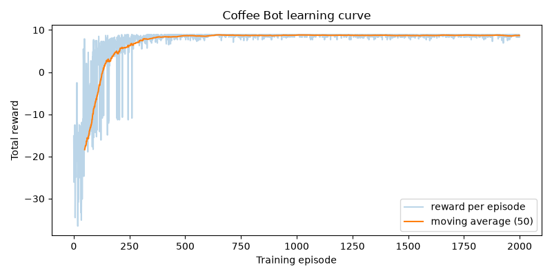

# Coffee Bot


A small reinforcement learning project. A robot learns, by trial and error, to cross a 7x7 office grid and reach a cup of coffee while avoiding walls and water spots.

## How it works

The project is split in three parts so each one can be tested alone:

1. **Environment** (`env/coffee_env.py`): the game logic, with no drawing. `reset()` puts the robot at the start and `step(action)` moves it and returns the new state, the reward and whether the episode ended.
2. **Agents** (`agents/`): a random agent used as a baseline, and a tabular Q-learning agent with epsilon-greedy exploration. `train.py` runs the learning loop and `evaluate.py` measures an agent.
3. **Rendering** (`render/pygame_view.py`): draws the grid with pygame. It only reads the environment and never changes it.

## Rules and rewards

| Event | Reward |
| --- | --- |
| Reach the coffee | +10 (episode ends) |
| Fall in water | -10 (episode ends) |
| Each step | -0.1 |
| Hit a wall or the border | -0.5 extra, the robot stays in place |

An episode also ends after 100 steps.

## Results

Evaluated over 500 to 1000 episodes with no exploration:

| Agent | Success rate | Water rate | Average reward |
| --- | --- | --- | --- |
| Random | 5.5% | 82.2% | -22.7 |
| Q-learning (2000 training episodes) | 100% | 0% | +8.9 |

The map is small and deterministic, so a trained agent always finds the shortest path.

## Learning curve

Reward of each training episode, with a moving average of 50 episodes. The robot makes many mistakes at first, then settles on the shortest path after about 500 episodes.



## Installation

```
git clone https://github.com/Jihanvall/coffee-bot.git
cd coffee-bot
python -m venv rl_env
rl_env\Scripts\activate
pip install -r requirements.txt
```

On macOS or Linux, activate with `source rl_env/bin/activate`.

## Usage

Watch the agent at several stages of learning (0, 30, 300 and 2000 training episodes):

```
python play.py
```

Run the tests:

```
pytest -v
```

The tests run without a screen, and GitHub Actions runs them on every push and pull request.

## Project structure

```
env/        game logic
agents/     random agent, Q-learning agent, training and evaluation
render/     pygame view
tests/      pytest test suite
play.py     watch the agent learn
```